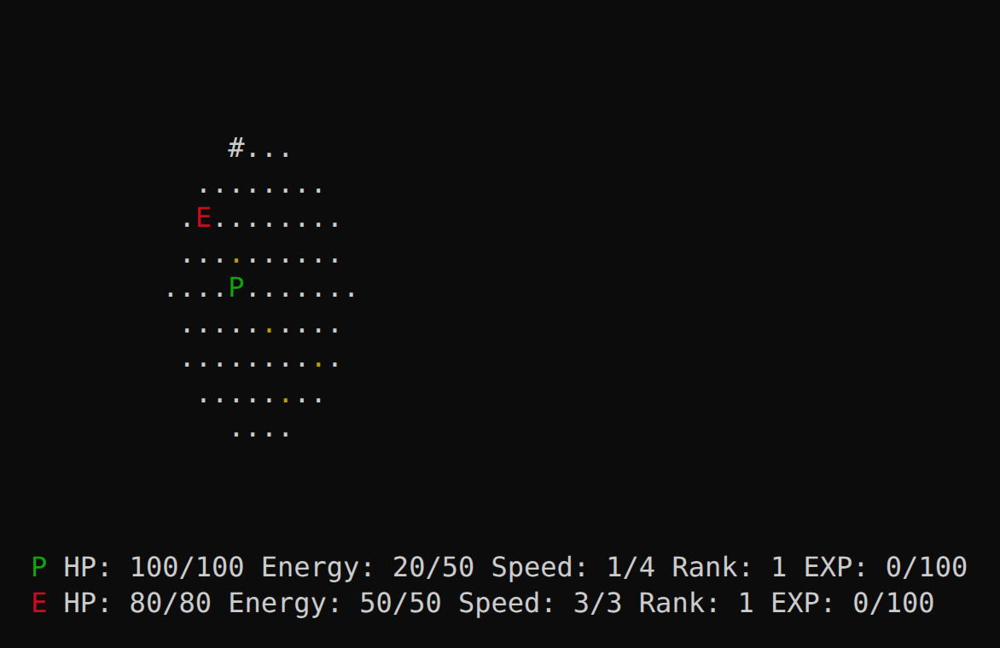
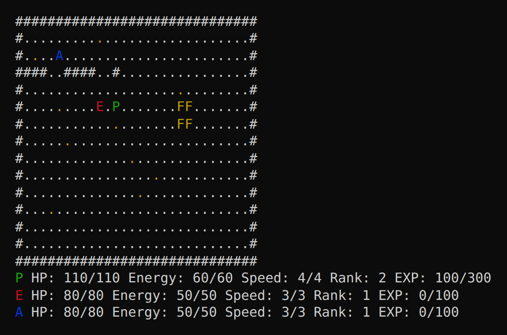
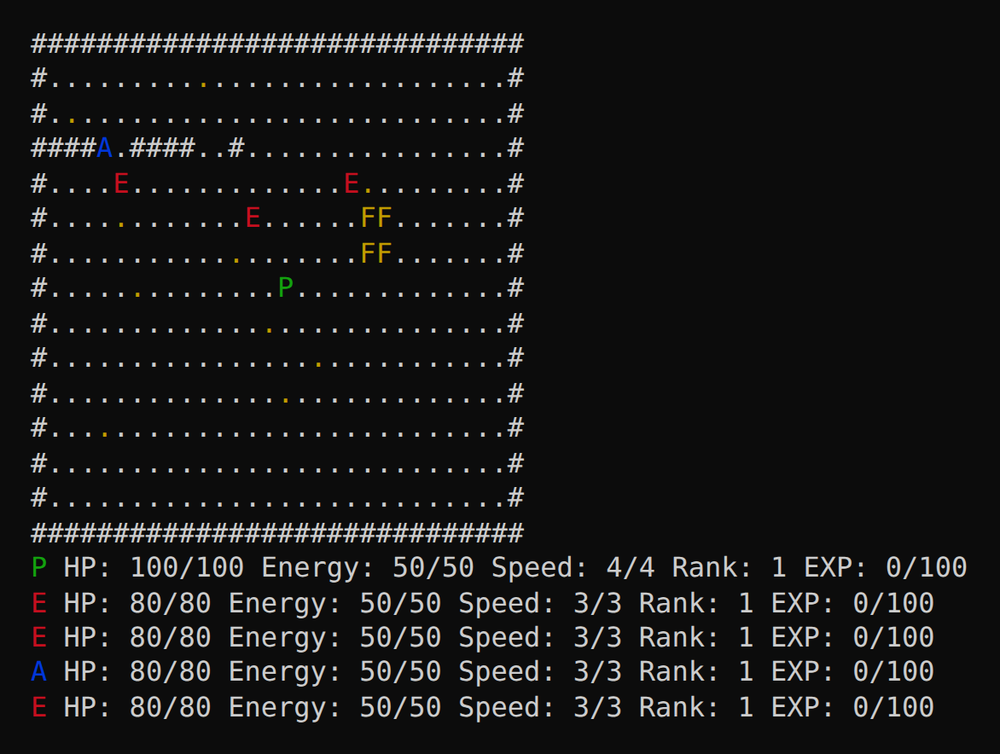
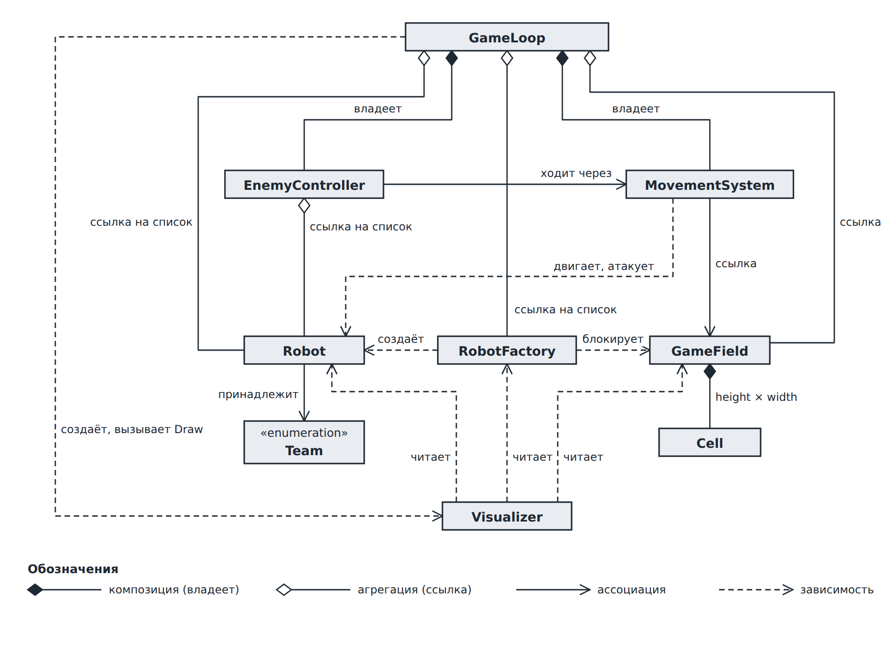

# Robot Game (C++)

A console turn-based tactical game written in C++20 as a university OOP project. You control a robot on a grid: move, fight enemy robots, fight alongside an ally, and level up. Enemies and allies are driven by a simple AI, a factory keeps spawning new enemies, and a fog of war limits what you can see.

The main goal of the project is not the game itself but the design: every class has one responsibility, guards its own invariants, and depends only on classes "below" it.

## Screenshots

Fog of war: only cells around the player are visible, explored cells stay on the map.



Rank up after killing an enemy (stats grow, energy and health are restored).



The factory (yellow `FF`) creates a new enemy next to itself every few turns.



## Gameplay

Enter a command and press Enter:

| Key | Action |
| --- | --- |
| `w` `a` `s` `d` | move up / left / down / right (or attack or heal when the cell is occupied) |
| `e` | end turn |

- Every action costs energy; a step also spends speed equal to the cell's movement cost (slow cells are drawn as yellow dots and cost 3).
- Moving into an enemy attacks it, moving into an ally heals it.
- Killing an enemy gives experience; a new rank raises health, attack and energy.
- After your turn all enemies and allies move, then factories may spawn new enemies.
- You win when no enemies are left, and lose when your robot dies.

Symbols: `P` player, `A` ally, `E` enemy, `F` factory, `#` wall.

## Architecture

Dependencies point strictly downward; there are no include cycles.

| Layer | Classes | Responsibility |
| --- | --- | --- |
| Data | `Team`, `Cell`, `GameField`, `Robot`, `RobotFactory` | State of the world, invariants |
| Rules | `MovementSystem` | Is a step or attack allowed, and what happens |
| Control | `GameLoop`, `EnemyController` | Turn order, player input, AI |
| View | `Visualizer` | Draws a frame, read-only |



Design decisions worth a look:

- **Cell vs. field.** `Cell` stores one cell's state, `GameField` owns the geometry and bounds checks, so every check is written exactly once. `GetCell` returns `const Cell&`, so a cell cannot be changed bypassing the field.
- **Two visibility flags.** `known` is only ever switched on (explored map stays), `visible` is recomputed after every player action.
- **`Visualizer` only reads.** `Draw` is `const` and takes `const` references, so rendering cannot change the game and the model never prints anything.
- **Movement is not part of `Robot`.** The decision "may I step here, and what happens if someone is there" depends on the robot, the field and the neighbour at once. A refused action never spends resources.
- **AI is separate from the loop.** `EnemyController` talks to the field only through `MovementSystem`: each enemy or ally moves toward the nearest hostile robot.
- **Factory returns a robot, the loop adds it.** Adding to the `std::vector` outside the AI loop keeps pointers to robots valid.
- **No magic numbers.** All numbers and symbols live in `config/game_constants.h`.

Patterns actually used: game loop, model/view separation, constructor dependency injection, simple factory (`RobotFactory::CreateEnemy`).

## Build and run

Requires a C++20 compiler.

**CMake** (also works directly in CLion):

```
cmake -S . -B build
cmake --build build
./build/OOP
```

**Make** (on Windows use `mingw32-make`):

```
make
./game
```

**Plain g++:**

```
g++ -std=c++20 -I. main.cpp robot/*.cpp cell/*.cpp gamefield/*.cpp movement/*.cpp gameloop/*.cpp visualizer/*.cpp robotfactory/*.cpp enemycontroller/*.cpp -o game
```

The terminal must support ANSI colors (Windows Terminal, PowerShell 7, most Linux/macOS terminals).

## Tests

A small test program checks that invalid data and invalid moves are rejected: wrong field size, a robot with zero health, a step into a wall or into a factory cell, and so on.

```
g++ -std=c++20 -I. tests/robot_game_tests.cpp cell/cell.cpp gamefield/gamefield.cpp movement/movement.cpp robot/robot.cpp robotfactory/robotfactory.cpp -o tests_run
./tests_run
```

## Project structure

```
main.cpp              sets up the field, robots and factory, starts the game
config/               game constants (numbers, keys, symbols)
robot/, cell/, gamefield/, robotfactory/      data layer
movement/             movement and attack rules
gameloop/, enemycontroller/                   turn order, input, AI
visualizer/           console rendering
tests/                checks for invalid data and moves
docs/                 UML diagrams
```
